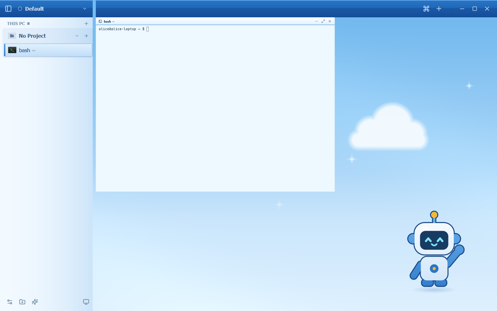

# Blue Window

A theme pack for [GoRex](https://github.com/si-mods/gorex): a 2007 desktop messenger in XP blues, with a sky of soft clouds, a few sparkles and a small waving robot. Light only.



The look follows the "Blue Window" preset of [codex-themes](https://github.com/freestylefly/codex-themes). The pack holds no image, code or text of that project: every picture in it is new art, drawn by the shaders in `assets/`. See [NOTICE](NOTICE).

## What it sets

- Seeds: the light palette of the preset, used for both appearances.
- Shaders: the window background (sky, clouds, sparkles, robot, and a soft light that follows the pointer over the sky), a glossy XP-blue title bar with white text, a light sidebar column, a chosen row with a blue accent bar and an inner border, and a pane header with a blue bottom line.
- Roles: the faces above (the title bar flat color is `#2876c8`), `pane.border` in the accent at 50%, and `button.background` in the accent.
- Metrics: corner scale 0.2, 1 DIP borders, Tahoma then Segoe UI, shadows at half size.
- Glass off. Terminal: Lumina Rayleigh Light.

## Install

This pack uses shader API version 2 (`"shaders": {"api": 2}`, docs/DSK-012-theme-shaders.md), so it needs GoRex 0.62.0 or later. An older build loads the colors and draws the faces and the background flat, with a warning.

```sh
gorex pack install gorex-theme-blue-window
```

This installs the pack from the [GoRex registry](https://github.com/si-mods/gorex-registry), so GoRex can update it later (`gorex pack update`).

Then select **Blue Window** on the Extensions page of the settings, or set `"appearance.theme": "gorex-theme-blue-window"` in `settings.json`.

## Params

Each shader declares its params in its own source (`//gorex:param` above each uniform), with a default that is the finished look and a range. The colors bind to the theme where they match it (`seed:accent`, `seed:bgBottom`), so `theme.json` sets no params. The background reads `Pointer`: a soft white light of radius `GlowSize` follows the pointer over the sky, a little brighter while the button is down. The sidebar column, the title bar and the panes are faces of their own, so the light never draws under text.

## Checks

Every shader passes GoRex's checks at load with no warning, over each declared range: `Fragment` only, no backdrop read, constant loops (at most 5 runs a pixel), cost under 8 times the built-in background, and text contrast on each face (4.5:1 for text, 3:1 for muted text, in the light appearance (the dark seeds equal the light ones)), with the pointer away, over the window and pressed.

## License

MIT, see [LICENSE](LICENSE).
