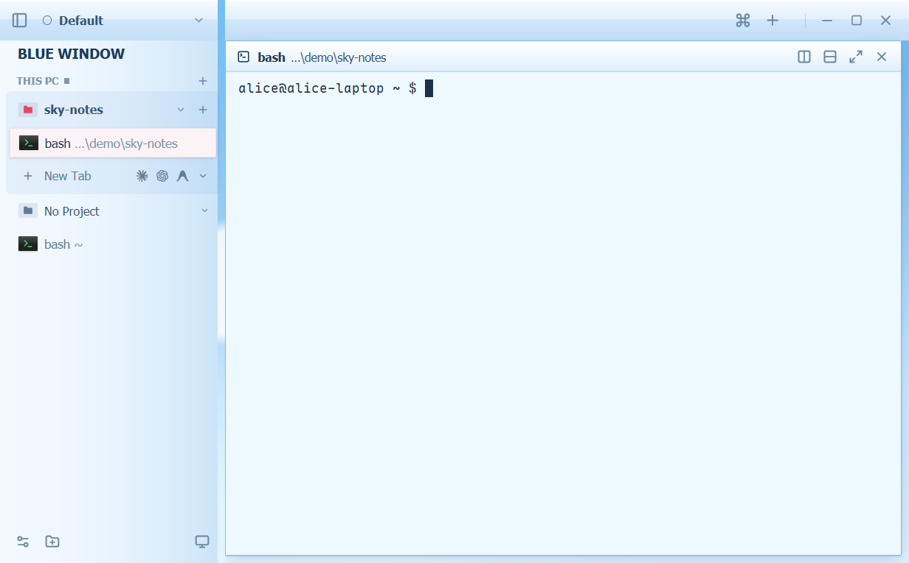

# Blue Window

A theme pack for [GoRex](https://github.com/si-mods/gorex): a 2007 desktop messenger in XP blues, with a sky of soft clouds, a few sparkles and a small waving robot. Light only.




The look follows the "Blue Window" preset of [codex-themes](https://github.com/freestylefly/codex-themes). The pack holds no image, code or text of that project: every picture in it is new art, drawn by the shaders in `assets/`. See [NOTICE](NOTICE).

## What it sets

- Seeds: the light palette of the preset, used for both appearances.
- Shaders: the window background (sky, clouds, sparkles, robot), and the faces of the title bar, the sidebar column, the chosen row and the pane header (glossy XP-style gradients).
- Roles: the faces above, `pane.border` in the accent at 50%, and `button.background` in the accent.
- Metrics: corner scale 0.2, 1 DIP borders, Tahoma then Segoe UI, shadows at half size.
- Glass off. Terminal: Lumina Rayleigh Light. Wordmark: BLUE WINDOW.

## Install

GoRex with theme shaders (docs/DSK-012-theme-shaders.md, phase 2) is needed. An older build loads the colors and drops the shaders, with warnings.

```sh
git clone https://github.com/si-mods/gorex-theme-blue-window
gorex pack install gorex-theme-blue-window
```

Then select **Blue Window** on the Extensions page of the settings, or set `"appearance.theme": "gorex-theme-blue-window"` in `settings.json`.

## Checks

Every shader passes GoRex's checks at load with no warning: `Fragment` only, no backdrop read, constant loops (at most 5 runs a pixel), cost under 8 times the built-in background, and text contrast on each face (4.5:1 for text, 3:1 for muted text, in the light appearance (the dark seeds equal the light ones)).

## License

MIT, see [LICENSE](LICENSE).
